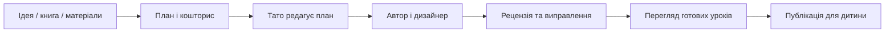

# Аудит UX/UI і майстерня навчального контенту

Дата: 2026-11-10. Автор: Codex, експертний огляд однією сесією; не незалежне юзабіліті-дослідження чи тестування з дитиною.

## Джерела й межі

Переглянуті реальні компоненти parent materials/books/courses/subjects, навігація, читачі уроків, video actions/storage, актуальна дизайн-система, попередні скриншоти власника. Браузерні перевірки нижче використовують справжні UI-компоненти з синтетичними даними, без доступу до приватного акаунта. Production `/parent/materials` без авторизації повертає HTTP 307 → `/login`; приватна сесія власника в цьому середовищі відсутня. Не підміняти це твердженням про огляд усіх production-даних. Дашборд прогресу й мотивація — окреме наступне завдання власника; їхня поведінка тут не визначається.

## Висновок

Функціональна база вже ширша, ніж навігація пояснює користувачу. Основна проблема — накопичені незалежні форми й кілька моделей уроку без єдиної ієрархії дій. Потрібно спершу впорядкувати задачі та контент, потім послідовно уніфікувати оформлення. Декоративні градієнти не замінять зрозумілого сценарію.

| Пріоритет | Знахідка та доказ у коді | Вплив | Рішення / критерій |
|---|---|---|---|
| P1 | `parent/materials/page.tsx`: ZIP, відео, книга та старі формати в одному потоці | Неясно, де почати; надто довга сторінка | Окремі вкладки: курс ZIP, відео, підручник/книга, додаткові матеріали; одна форма за раз. Старі імпорти окремо. Вибір не скидає поточну завантажувану форму |
| P1 | `VideoLessonsPanel`: тільки список предмета та видалення, немає загальної бібліотеки/батьківського перегляду/скачування/заміни | Файли важко знайти й обслуговувати | Відеотека: пошук за темою, фільтр предмета/курсу, кількість/розмір, перегляд, скачування, заміна, підтверджуване видалення |
| P1 | Відеозаміна відсутня; звичайне завантаження завжди додає новий рядок | Ручне видалення перед новим upload створює ризик втрати | Спершу завантажити й перевірити новий файл, потім змінити прив'язку наявного відео. При збої старий залишається; ID/topic/order зберігаються, конкурентна заміна відхиляється |
| P1 | П’ять імпортних readers і окремі text/voice composers | Різна поведінка, кроки й кнопки | Спільна оболонка уроку: заголовок, місце в курсі, вміст, постійне home, наступний крок, доступні відео, один чат; поступово, зі збереженням старих IDs/progress |
| P2 | Більшість parent forms `w-full`, заголовки 13–15px, багато однакових bordered panels | На широкому екрані немає виразного центру; підказки важко сканувати | Контент до ~1200px; одна головна дія; заголовок 24–28px; текст 14–16px, helper не менше 12–13px; вертикальний ритм 8/16/24; довгі рядки 60–75 знаків |
| P2 | Emoji як основні різнорідні іконки, різна щільність кнопок | Вигляд набору прототипів | Єдина лінійна іконографіка з підписами, обмежена палітра, 44px touch targets, видимий focus, м’які поверхні; теми зберегти |
| P2 | У legacy lesson/chat компонентах поєднання `bg-primary text-white`; світлий child primary #ff7a50 | Білий дрібний текст на коралі має низький контраст; дизайн-документ заявляє AA без достатнього підтвердження | Окремо перевірити всі CTA у двох темах і обрати темний текст/темніше тло; не змінювати всю палітру без регресії читачів |
| P2 | `Sidebar`: багато пунктів, меню телефона з overlay без явного focus trap/Escape | Навігація шумна, keyboard use може бути незручним | Групи «Навчання», «Матеріали», «Керування»; потім доступний dialog для mobile drawer, overflow на малих висотах; об’єднання маршрутів лише з redirects |
| P1 | `parent/courses/[id]` досі показує current-topic/forecast/library/start старого pipeline | Курс без підручника не має зрозумілого шляху до нового готового уроку | Під час реалізації майстерні замінити ці залежності каталогом draft/published; не вважати створення назви курсу генерацією курсу |
| P2 | Курси вже є окремим `subjects.kind=course`, групами й правилами видимості | Немає потреби хардкодити Roblox окремим шкільним предметом | «Шкільні предмети» і «Мої курси»; курс може бути з ідеї, книги, власних матеріалів або ZIP. Назва нового курсу не потребує нової схеми |
| P2 | Стан video upload лише «завантаження», невідомо коли завершиться | Очікування сприймається як зависання | Наступний зріз: справжній byte progress і окремий етап перевірки, скасування upload, відновлення після збою; не малювати фіктивні відсотки |

## Інформаційна архітектура

Батьківський кабінет:

- Предмети — шкільний каталог і наявні уроки.
- Курси — позашкільне навчання, проєкти та творчість; згодом створення з ШІ.
- Додати матеріали — вибрати тип, завантажити, перевірити, підтвердити результат.
- Відеотека — керування вже завантаженими відео; прикріплення лишається до теми.
- Мої книги — бібліотека джерел, читалка та доступність для створення курсу.
- Майстерня ШІ (наступний етап) — завдання на створення/доповнення, чернетки, етапи, витрати, публікація.

Один файл може бути джерелом кількох курсів. Відео — додатковий матеріал конкретного уроку, не другий список уроків над основним. Видалення відео не видаляє текстовий урок. Шкільний предмет, курс і джерело — різні сутності, а не три назви одного upload.

## Сценарій «Створити курс з ШІ»

1. **Задум.** Вільний запит; вік/підготовка, бажаний результат, мова, формат, доступні час і інструменти. Не вимагати підручник, шкільний клас чи готові lessons JSON. Поля з розумними початковими значеннями, уточнення лише там, де відповідь змінює курс.
2. **План.** ШІ пропонує результат навчання, модулі, 1 пробний урок, практичний підсумковий проєкт, приблизний час і кошторис. Тато може скоротити/замінити модулі або змінити рівень. Кошторис з допустимою межею перевитрати; повна генерація лише після погодження плану в інтерфейсі.
3. **Підготовка.** Видимі етапи, чернетки й помилки по модулю; можна зупинити або повторити лише невдалу частину. Вихід зі сторінки не зупиняє серверне завдання й не означає, що курс готовий.
4. **Перевірка.** Повний preview так, як побачить дитина: пояснення, приклади, інструкції, ілюстрації, вправи, озвучення. Видно джерела, обмеження, фактичну модель, витрати та результати рецензії. Відхилене зображення можна перегенерувати окремо.
5. **Публікація.** «Зберегти чернетку» і «Опублікувати для дитини». Генерація не активує предмет і не переписує чинний курс. Версії й редагування без втрати проходження.

### Приклади приймання

**Roblox, 11–12 років:** початківець без підручника; чіткі результати Studio/Luau, керування об’єктами, події й змінні, тестування; практичний мініпроєкт, пояснення кожного фрагмента коду. Версійні API перевіряються за Roblox Creator Hub, а не лише пам’яттю моделі; приклади перевіряються виконанням/статичним аналізом там, де є надійний runtime. Не заявляти автоматичне тестування Roblox Studio в Linux, якщо його немає. Публікація гри, спілкування й витрати Robux не потрібні для базового курсу.

**Шпаківня або органайзер:** 1 заняття чи короткий курс, вибір результату/матеріалів/доступних інструментів; точні розміри й перелік деталей; послідовні кроки; схеми з узгодженими розмірами; окремі дії дорослого для різання/свердління. Ілюстрація відповідає саме цьому кроку. Для органайзера можна запропонувати картонний варіант; для шпаківні розміри/матеріали й місце встановлення мають спиратися на обраний вид птахів і надійне джерело. Не генерувати довільну красиву картинку замість технічної схеми.

**Курс за книгою:** тато вибирає джерело/сторінки й мету; видимий звіт, які сторінки прочитано й де OCR непевний. Біографії/художні уривки/пояснення не замінюються переліком питань. Новий pipeline не реактивує автоматично стару масову підготовку й індексацію, які власник прибрав із предметів.

## Агенти як частина продукту

Це серверні ролі з окремими контрактами й журналом. Вони не є доступом до браузерної сесії Claude Code чи ChatGPT, а API-адаптерами, керованими додатком. Не приписувати Gemini можливості живого пошуку або відеогенерації до підключення конкретного сервісу/моделі.

| Роль | Вхід → перевірений результат |
|---|---|
| Оркестратор | Запит/бюджет → workflow, контроль стану, повтори, збірка |
| Методист | Вік/мета/рівень → план, цілі, метод навчання, критерії успіху |
| Предметний автор | Погоджений план/джерела → конкретний урок, приклади, практика |
| Дизайнер матеріалів | Структура уроку → storyboard, точні visual briefs, alt text, ілюстрації/схеми |
| Рецензент | Чернетка/джерела → перевірка фактажу, повноти, віку, практичної безпеки; виправлення |
| Збирач | Лише перевірені модулі → версія курсу, прив’язки медіа, preview |

Окремі ролі не зобов’язують викликати кілька моделей для кожного абзацу. Спершу один якісний автор і незалежний review-pass, з вимірюваним бюджетом. OpenAI може писати/спілкуватися, Claude аналізувати, Gemini створювати медіа, але вибір має спиратись на тестові результати, фактичні API й ціни; журнал provider/model для кожного етапу. Pictory: поточний експорт сценарію залишається; API і короткі Gemini/Veo-фрагменти — окремі адаптери з окремою оцінкою вартості.

## Технічний шлях без ще однієї схеми на кожен предмет

Внутрішня універсальна модель CourseDraft → modules → lessons → typed blocks (пояснення, читання, вправа, код, практичний крок, ілюстрація, відео, перевірка). Є версія контракту, джерела й медіапосилання, prerequisite/safety flags і public/private розмежування відповідей тестів. Формат не залежить від назви предмета. Старі ZIP/readers лишаються через адаптери; нові автори генерують цей контракт, а не HTML сторінки чи SQL.

Стійкі jobs + checkpoint по модулю, idempotency, schema/content validation, source hashes, перевірка медіа, budget reservation перед етапом та фактичні витрати після. Чисте збереження draft окремо від publish; generation errors не потрапляють дитині як навчальні тексти. Не запускати тривалу генерацію цілого курсу в одному HTTP-запиті Vercel. Таблиці/міграції будуть окремою реалізацією; у поточному зрізі їх немає.

## Послідовність реалізації

1. **Зараз:** окремі сценарії додавання + загальна відеотека (перегляд/скачування/заміна/видалення); без нових paid AI calls. Записи/файли самі не видаляються під час deploy.
2. **UI-основа:** узгоджені заголовки/поля/стани; читач уроку і компактна панель розмови; mobile keyboard/safe areas, контраст/фокус. Не весь дизайн за один реліз.
3. **Пробна майстерня:** задум → план → один повний урок → рецензія → ручна публікація. Пілот Roblox та практичний органайзер із вимірюванням ціни/якості.
4. **Повний курс:** стійкі багатокрокові jobs, книги/джерела, версії, selective regenerate; ілюстрації. Відео після перевірки якості й бюджету.
5. Дашборд проходження й мотивація — після окремого опису власника. Поки лише зберігати наявні progress events, не вигадувати нову систему балів.

Критерій якості: тато без документації знаходить потрібний тип додавання; керує одним відео без повторного імпорту курсу; дитина відкриває готовий урок без технічних інструкцій; пробний курс дає практичний результат, а не просто список тем.

## Що реалізовано цим релізом

Чотири окремі вкладки в «Завантажити матеріали», збереження вибраного архіву/чернетки при перемиканні, блокування перемикання під час active busy operation. Книги ведуть у чинну бібліотеку; додаткові матеріали використовують чинний PDF/EPUB pipeline без підміни його ZIP-імпортом. Технічні старі формати залишилися згорнутими окремо.

Новий пункт «Відеотека»: family-scoped список, пошук/предмет, metadata size/date, native modal preview, signed download, replace та confirm delete. Preview не вимагає видимості предмета дитині; батьківська авторизація обов’язкова, child visibility rules не змінені. Відео при закритті modal явно зупиняється й звільняється. Заміна зберігає ID/topic/created_at, створює новий storage path і перевіряє MIME/size/presence перед compare-and-swap. Невдалий update не видаляє старий файл. Збої cleanup явно показуються як збережена зміна з залишком файлу, а не як успішне повне очищення. Невикористаний новий upload після помилки completion може залишитися у сховищі; автоматичний janitor тут не додавався.

Наявний список відео в предметі має посилання на відеотеку; sidebar прокручується на низьких екранах. У цьому зрізі немає нового ШІ-генератора курсів/ілюстрацій, змін до уроків, paid AI calls чи SQL-міграцій. Редагування назв самих відео/thumbnail/transcoding, масштабована серверна пагінація та byte progress — наступні можливості, а не приховані обіцянки цього UI.

Перевірки: 1901 unit-тест, TypeScript, production build, ESLint 0 errors / 8 попередніх warnings; client bundle 104 файли / 0 marked leaks. Chromium 320/390/768/1440 × light/dark: справжні компоненти з mock actions/storage, пошук/фільтр, збереження форми між вкладками, native video modal зі справжнім синтетичним MP4, Escape/звільнення media, заміна/видалення без мережевих мутацій. Server тести перевіряють parent/family authorization, приватні download URLs, відхилення чужих шляхів/тем, metadata verification, невдалий update та cleanup failure. Приватні production-файли в аудиті не видалялися й не замінювалися.
