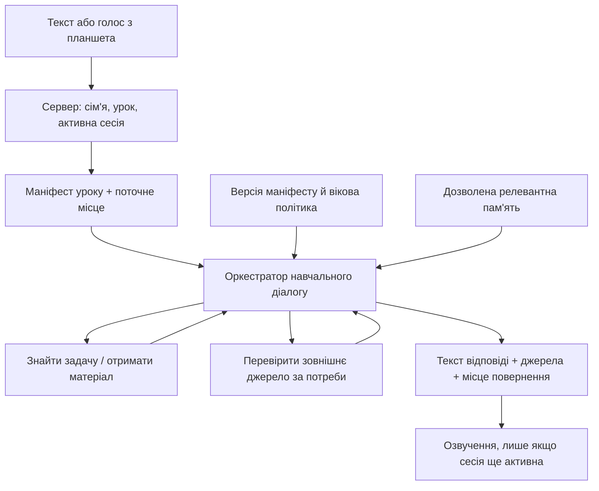

# Пропонована архітектура

Це цільовий дизайн, не опис уже запущених сервісів. Точні точки зміни та спостереження: [аудит](sources-and-decisions.md).

## 1. Одна навчальна розмова для тексту й голосу

Голос — транспорт, а не окремий обмежений педагог. Зберегти наявні lease/revision, heartbeat, переривання, один активний turn і перевірку активності перед видачею аудіо. Скасування поширюється на внутрішні інструменти. Додавання інструмента не дозволяє обійти сімейний бюджет, роль користувача чи ізоляцію сімей.

## 2. Контекст уроку й доступ до задач

Зараз `voice/lessonContext.ts` передає обмежений поточний блок, а `lessons/chat.ts` має окрему гілку voice+stepContext, що оминає звичайний пошук задач. Потрібен спільний серверний resolver, а не нескінченне збільшення prompt.

Пропоновані контракти:

| Контракт | Мінімальний зміст і перевірки |
|---|---|
| `LessonManifest` | Версія; довірені lesson/book/subject IDs; revision матеріалу; заголовки/IDs усіх кроків; `original_number` і підпункти; IDs читань/ілюстрацій; поточний step ID |
| `find_exercise` | Номер/підпункт, поточна книга/урок; результат `found / ambiguous / not_found / unavailable`; кандидати з походженням |
| `get_lesson_item` | Умова/потрібний текст, сторінка, тип, доступні ілюстрації; серверна авторизація IDs щоразу |
| `get_visual_context` | Авторизований файл/фрагмент сторінки, перевірений MIME/розмір, підтримка vision/OCR і окремий бюджет; чесна відмова якщо не підтримується |
| `search_sources` | Неперсональний предметний запит; перевірені URL, назва, дата, уривок; таймаут, бюджет і скасування |
| `TutorTurnResult` | Відповідь; походження фактів/цитати; фактична використана задача; поточний і відкладений step; службові usage/latency без повного приватного prompt |

Інструментам передаються тільки дозволені аргументи; family/child IDs прив’язує сервер, не модель. Неприпустимий ID з чужої сім’ї не можна прочитати навіть якщо його назвала дитина або вебсторінка.

`searchMathCourseV2` вже шукає `original_number`; використати його з пріоритетом поточної книги/уроку, а не дублювати. Для інших сімейств матеріалів — адаптери до спільного інтерфейсу. Завантажувати компактний повний перелік уроку, а повний текст — вибірково. Довгі тексти не обрізати посеред ключової умови без ознаки усічення. Teacher keys не включати до маніфесту чи браузерної розшифровки.

Контекст має три незалежні виміри: `current_step`, `focus_item` (наприклад №357 з іншого кроку), `return_anchor`. Відступ не переписує прогрес уроку. Змінений/перезавантажений пакет інвалідовує кеш за revision; повернення до видаленого step пропонує найближче доступне місце.

## 3. Загальні знання й перевірений пошук

Почати зі скасування суперечливого обмеження підручником і коректної роботи з власними матеріалами. Вебпошук — наступний окремий адаптер. Саме додавання кількох слів у prompt не створює пошукового інструмента.

Провайдерський tool-enabled виклик або контрольований серверний пошук має повертати structured citations; джерела зберігаються для конкретного turn. Модель не може сама позначити неперевірений URL як підтверджений. Перевіряємо доступність і відповідність уривка твердженню; для дискусійного питання за можливості порівнюємо незалежні джерела. Не обіцяємо істинність лише через наявність citation.

Якщо сервер сам завантажує сторінки, потрібні дозволені протоколи, заборона приватних/службових IP, обмеження redirect, розміру й часу; це окрема поверхня SSRF. Пошуковий текст не може ініціювати довільні мережеві запити або shell. Дитині показується короткий перевірений опис, а відкриття зовнішніх сторінок узгоджується з батьківською політикою. Чинну blanket-заборону посилань у safety preamble замінити цим контрольованим правилом.

Не міняти основного постачальника дитячого діалогу в межах підключення Gemini до розробки. Для кожного нового runtime-постачальника окремо перевірити вікові умови, retention і передачу даних. Див. важливі конкретні умови [OpenAI та Gemini](sources-and-decisions.md).

## 4. Пам’ять: окремий керований шар

Історія повідомлень сама по собі не є профілем. Пропоновані логічні сутності (назви й SQL ще не затверджені):

| Сутність | Призначення |
|---|---|
| `processing_authorizations` | Дозволені цілі/категорії пам’яті, стан, версія повідомлених умов, ініціатор і час надання/відкликання; відкликання зупиняє відповідне читання/запис |
| `learner_preferences` | Явні побажання, інтереси, джерело child/parent, стан, timestamps, версія |
| `learning_observations` | Обмежене спостереження, посилання на подію-доказ, впевненість, review/expiry, прийнято/відхилено |
| `skill_evidence` | Навичка, завдання/результат, рівень допомоги, час; окремо від мотиваційних припущень |
| `memory_suppressions` | Мінімальний ключ забороненої до повторного виведення концепції; час/обсяг, без копії видаленого чутливого факту |
| `memory_audit` | Подія створення/виправлення/видалення й ініціатор без повторного збереження стертої суті |

Усі записи прив’язані до сім’ї/дитини, з RLS і серверними перевірками. Додаткова пам’ять передається моделі лише в мінімальному доречному вигляді. Ім’я та повна біографія для прикладу з дробами не потрібні.

Життєвий цикл: явне побажання → дозволений запис; неявне спостереження → кандидат → перевірка достатності доказів → обмежений запис зі строком перегляду. Один невдалий turn не доказ стійкої властивості. Межі безпеки задає тато; поточні власні побажання дитини щодо темпу й прикладів переважають старі записи про її інтереси. Якщо тато записав «любить футбол», а дитина просить без футбольних прикладів, виконати її прохання одразу, позначити конфлікт для перегляду й не наполягати до адміністративного виправлення. Виправлення факту не переписує батьківські межі безпеки. Модель не робить необмежений SQL write; пам’ять змінюється через валідовані команди.

Команда «забудь» має два зрозумілі режими: перестати використовувати для персоналізації; видалити відповідні вихідні дані/історію в доступному обсязі. Не обіцяти стирання історії, якщо збережено батьківський журнал. Suppression діє на повторну побудову з історії, summaries, embeddings і кешів. Для мінімізації tombstone розглянути HMAC нормалізованої концепції з серверним ключем; не вважати простий хеш низькоентропійного факту анонімізацією. Перевірити відновлення backup: видалення/заборони мають повторно застосовуватися. Строки retention, backup і provider deletion документуються до запуску, а не вигадуються в інтерфейсі.

Міграції додавати поступово, з вимкненою персоналізацією за замовчуванням до готовності UI керування. Вимкнення прапорця зупиняє читання й запис, але не маскує вже збережені дані від екрана видалення. Перехід навчального року змінює активну програму, зберігає корисні навички й переглядає застарілі уподобання. Експорт — читабельний JSON з версією, походженням і без секретів.

## 5. Вартість і спостережуваність

Використати наявний budget/model router. Облік turn: STT, модель/токени, інструменти, пошук, TTS, помилки, скасування. Витрати розробницьких агентів рахувати окремо від дитячих уроків.

Початковий вимір: p50/p95 від завершення репліки до першого звуку, частка знайдених задач, перезапитів номера, помилкових «немає», скасованих/запізнілих озвучень, пошукових викликів і вартість змістовної розмови. Не підміняти педагогічну користь тривалістю перебування чи кількістю повідомлень. Порівнювати конфігурації на одному синтетичному наборі; фактичні суми й цілі встановити після baseline, без вигаданої ціни «за урок».

Два різні контури: дитячий runtime на Vercel/Supabase; команда розробки на ізольованих worker/CLI з GitHub. Помилка або компрометація агента розробки не має давати доступ до дитячих записів.
